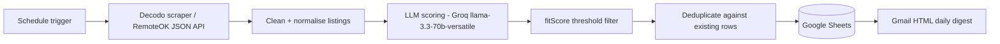

# n8n Job-Matching Pipeline

An automated, end-to-end job-hunting pipeline built in **n8n**. It pulls fresh job listings from the RemoteOK API, scores each one against my profile with an LLM, saves deduplicated results to Google Sheets, and emails me a daily HTML digest of the best matches.

I built it because manually checking job boards every day was slow and inconsistent. Now the filtering happens automatically and I only read the shortlist.

## How it works



1. **Fetch** - listings are pulled through Decodo from the RemoteOK JSON API.
2. **Normalise** - inconsistent, unstructured fields are cleaned into a comparable shape.
3. **Score** - an LLM rates each listing against a structured rubric and returns a `fitScore`.
4. **Filter** - listings below the `fitScore` threshold are dropped.
5. **Persist** - new matches are written to Google Sheets, skipping ones already stored.
6. **Report** - a Gmail HTML digest summarises the best matches.

## Stack

| Layer | Tool |
|---|---|
| Orchestration | n8n (cloud) |
| Data source | RemoteOK JSON API via Decodo |
| Scoring | Groq `llama-3.3-70b-versatile` (free tier) |
| Storage | Google Sheets |
| Reporting | Gmail (HTML digest) |

## Setup

1. Import `workflows/job-matching-pipeline.json` into n8n (**Workflows -> Import from file**).
2. Create the credentials listed in `.env.example` inside n8n (nothing secret lives in this repo).
3. Point the Google Sheets nodes at your own sheet and make sure tab names match the workflow.
4. Set your profile and scoring rubric in the scoring node (see `docs/scoring-rubric.md`).
5. Run once manually, check the sheet and digest, then enable the schedule trigger.

## Design decisions and lessons

- **Provider changes:** scoring moved from Gemini to OpenAI `gpt-4o-mini` and finally to Groq, mainly because of free-tier capacity limits. Details in [`docs/lessons-learned.md`](docs/lessons-learned.md).
- **Data source:** the first design used The Muse API; I rebuilt around RemoteOK's JSON API because it is more stable than scraping HTML pages.
- **Scoring is not blindly trusted:** thresholds were tuned over several runs against listings I judged by hand.

See [`docs/architecture.md`](docs/architecture.md) for the node-by-node breakdown.

## Repository layout

```
.
├── README.md
├── docs/
│   ├── architecture.md
│   ├── lessons-learned.md
│   └── scoring-rubric.md
├── workflows/
│   └── job-matching-pipeline.json   <- your sanitised n8n export goes here
├── assets/                          <- screenshots of the workflow canvas and digest
├── .env.example
└── LICENSE
```

## Author

Ayush Anand - B.Tech CSE (AI/ML), DIT University, Dehradun
GitHub: [anandayush619](https://github.com/anandayush619)
